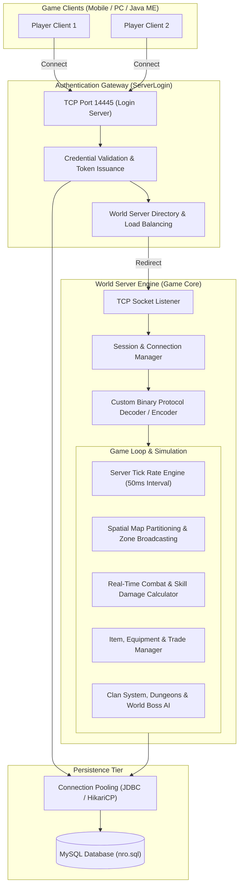

# Ngọc Rồng Online (NRO) — MMORPG Java Game Server Core

[](https://www.oracle.com/java/)
[](https://maven.apache.org/)
[](https://www.mysql.com/)
[](https://en.wikipedia.org/wiki/Network_socket)

> An asynchronous, high-throughput multi-threaded **Java Game Server Core** for the 2D MMORPG **Ngọc Rồng Online (Dragon Boy)**. Features custom binary packet serialization, concurrent session management, spatial world partitioning, real-time combat calculation, and relational data persistence in MySQL.

---

## 1. System Architecture



---

## 2. Key Engineering Highlights

* **High-Concurrency Socket Networking**:
  * Asynchronous TCP non-blocking I/O socket listener capable of maintaining thousands of concurrent persistent connections with low latency.
  * Custom binary packet protocol with bitwise serialization/deserialization for minimal bandwidth consumption over mobile cellular networks.
* **Spatial World & Zone Partitioning**:
  * Divides game maps into discrete zones/sub-areas (`ZoneManager`), ensuring entity updates (player movement, monsters, skill effects) are broadcasted only to players within visual proximity, optimizing CPU and network overhead from $O(N^2)$ to $O(K)$.
* **Deterministic Server Tick Rate**:
  * Fixed-timestep game loop updating monster state machines, cooldown counters, passive regeneration, and damage calculations independently of client frame rates.
* **Robust Anti-Cheat & Server-Authoritative Logic**:
  * All movement velocities, damage outputs, cooldown validations, inventory mutations, and item drops are computed and validated strictly server-side.
* **Transactional Persistence & Thread Safety**:
  * Concurrent thread-safe collections (`ConcurrentHashMap`, `CopyOnWriteArrayList`) preventing race conditions during peer-to-peer trading, party formation, and inventory swaps.
  * Batched asynchronous database writes for player progress to prevent game loop stalls.

---

## 3. Tech Stack

| Domain | Technology |
| :--- | :--- |
| **Language** | Java 8 / 11+ |
| **Build Tool** | Apache Maven (`pom.xml`), NetBeans Project (`nbproject`) |
| **Networking** | Java Socket & NIO, Custom Binary Framing |
| **Database** | MySQL 5.7+ / 8.0, JDBC, HikariCP Connection Pool |
| **Architecture** | Client-Server Architecture, Authoritative Game Server |

---

## 4. Getting Started

### Prerequisites
- [JDK 8 or 11](https://www.oracle.com/java/technologies/downloads/)
- [Apache Maven](https://maven.apache.org/)
- [MySQL 5.7+](https://www.mysql.com/)

### Database Setup
1. Create a MySQL database (e.g. `nro_server`).
2. Import the schema and initial game data:
   ```bash
   mysql -u root -p nro_server < nro.sql
   ```

### Configuration & Running
1. Open `config/` (or update database credentials in the configuration files).
2. Build the server JAR:
   ```bash
   mvn clean package
   ```
3. Run the compiled server:
   ```bash
   # Windows
   run.bat
   # Linux
   java -jar target/nro-server.jar
   ```

---

## 5. Author & License

- **Author**: Nguyễn Bảo Toàn ([@btoan2802](https://github.com/btoan2802))
- **License**: Educational / Proprietary
